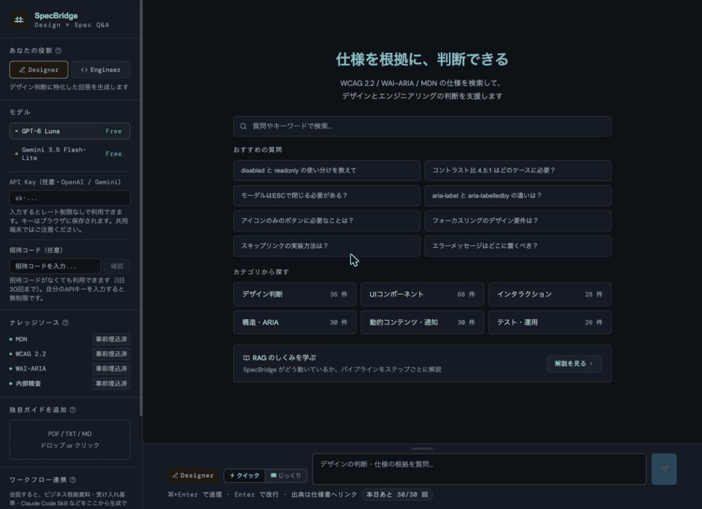
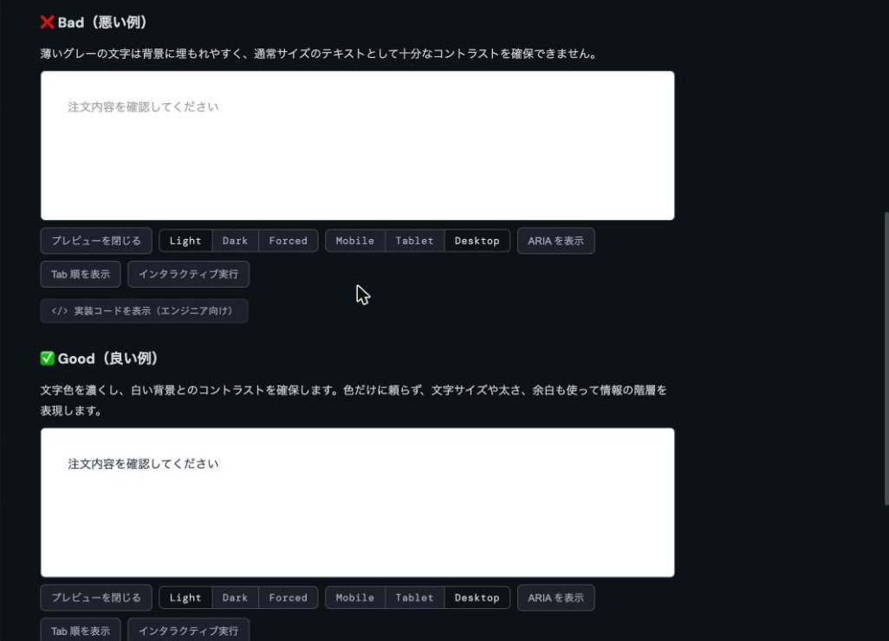
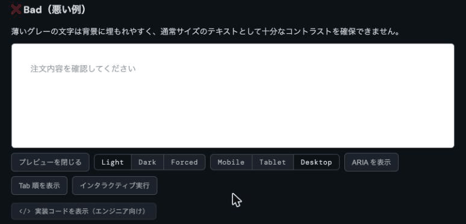
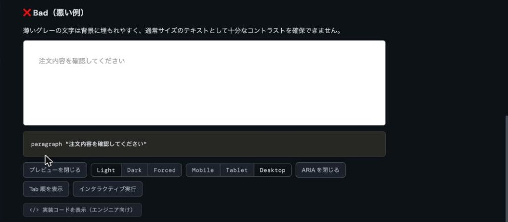
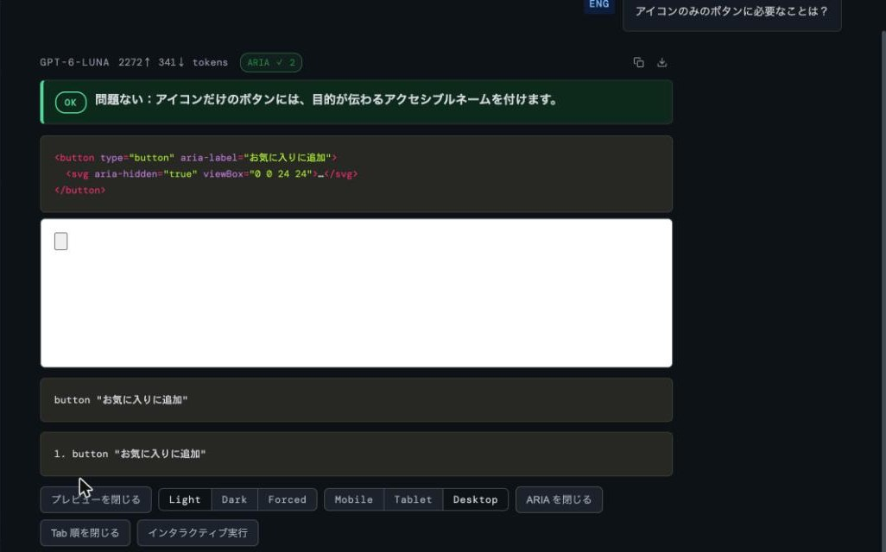
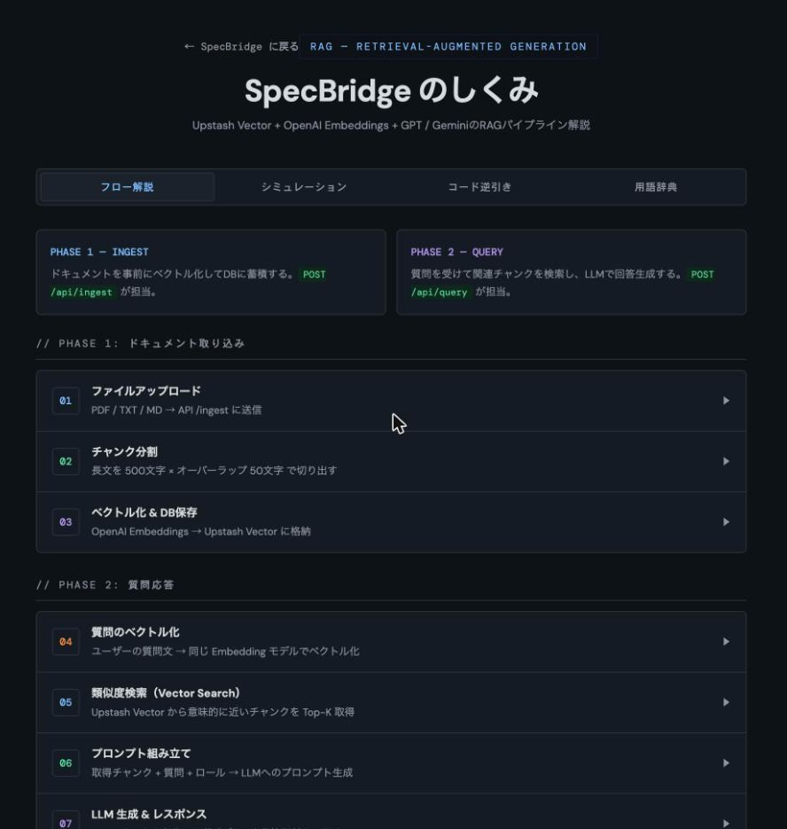
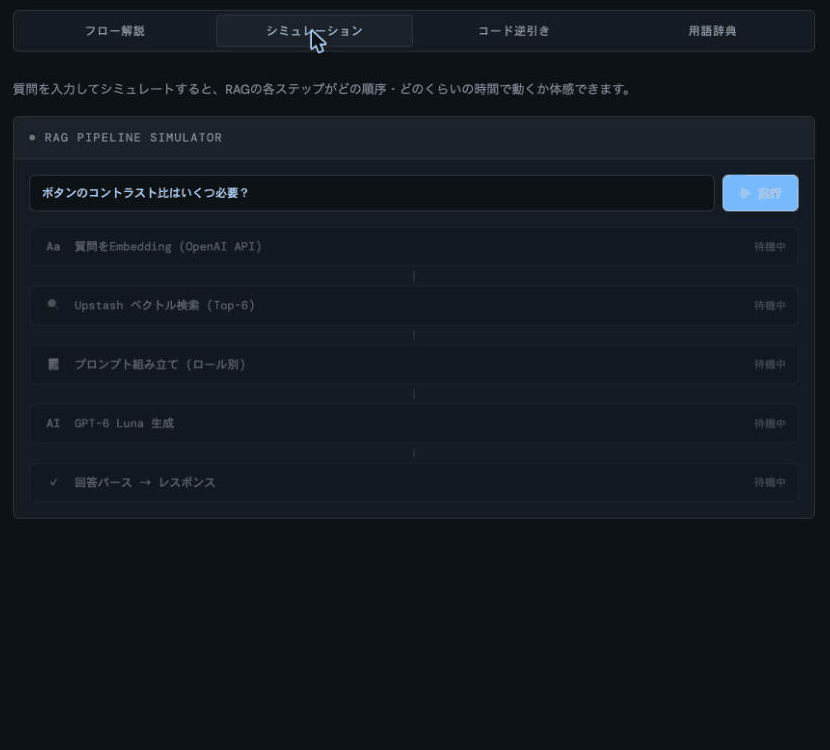
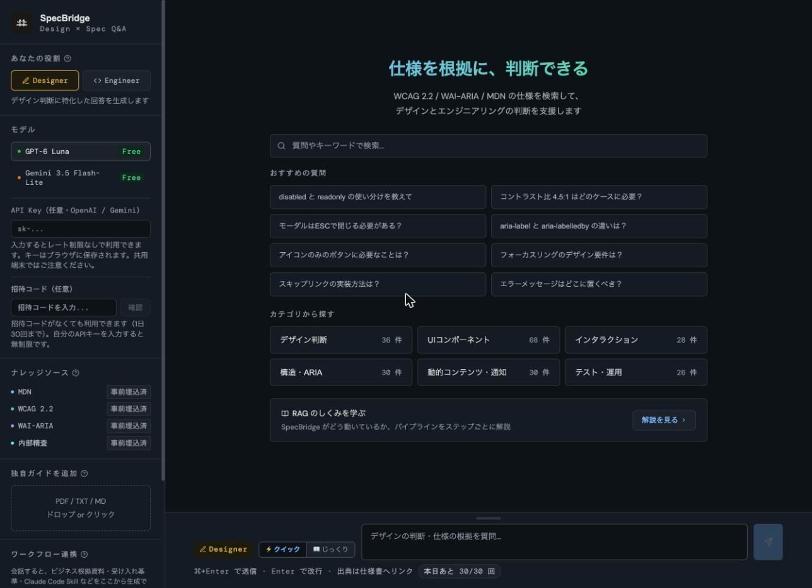
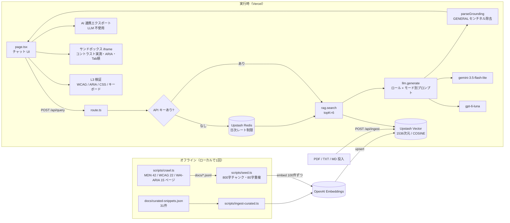

# SpecBridge

> 仕様を根拠に、判断できる

WCAG 2.2 / WAI-ARIA / MDN の仕様を根拠に、デザインと実装の判断を支援する RAG（検索拡張生成）アプリケーションです。質問すると、仕様の該当箇所を検索し、その内容に沿って LLM が回答します。回答に含まれる WCAG 番号・ARIA 属性・CSS プロパティは辞書で照合し、存在しないものが混ざっていないかを画面に表示します。

- 本番: https://spec-bridge.vercel.app/
- 仕組みの解説ページ: https://spec-bridge.vercel.app/learn

この README はエンジニア向けの技術資料です。利用者向けの機能説明は「[機能一覧](#機能一覧)」に、再設計の経緯は [`docs/UX-REDESIGN.md`](docs/UX-REDESIGN.md) に、Vercel への手順は [`DEPLOY.md`](DEPLOY.md) にあります。

## 画面

### 質問から判定まで

おすすめの質問を押すと、仕様を検索して回答します。クイックモードでは 1 行目が判定（OK / NG / 条件付き）になり、回答に出てきた WCAG 番号は辞書と照合済みであることをバッジ（`WCAG ✓ 1`）で示します。



### Good / Bad の見た目のプレビュー

「詳しく展開」すると、悪い例と良い例を同じ文言で並べて描画します。デザイナー向けではコードを折りたたみ、見た目だけを見せます。



### テーマと画面幅の切り替え

プレビューは Light / Dark / Forced（Windows ハイコントラストの擬似再現）と、Mobile / Tablet / Desktop を切り替えられます。下の例では、薄いグレーの文字が Dark では白い帯の中に残り、Forced では強制的に黒地に白文字へ置き換わります。



### 読み上げと Tab 順の簡易再現

「ARIA を表示」でスクリーンリーダーが読む内容（ロールとアクセシブルネーム）を、「Tab 順を表示」で Tab キーで到達する順番を表示します。

| デザイナー向け（段落の読み上げ） | エンジニア向け（アイコンボタンの読み上げと Tab 順） |
|---|---|
|  |  |

エンジニア向けの回答ではコードを先に表示し、使われた ARIA 属性が実在するかをバッジ（`ARIA ✓ 2`）で示します。

### RAG の仕組みを学ぶページ

`/learn` では、検索拡張生成の流れを段階ごとに解説し、シミュレーターで各段階の順番と所要時間を確かめられます。

| フロー解説 | シミュレーター |
|---|---|
|  |  |

### トップ画面



---

## 目次

0. [画面](#画面)
1. [技術スタック](#技術スタック)
2. [アーキテクチャ](#アーキテクチャ)
3. [ディレクトリ構成](#ディレクトリ構成)
4. [RAG パイプライン](#rag-パイプライン)
5. [LLM 層](#llm-層)
6. [L3 ハレーション防止（出力検証）](#l3-ハレーション防止出力検証)
7. [HTML プレビューのサンドボックス](#html-プレビューのサンドボックス)
8. [AI 連携エクスポート](#ai-連携エクスポート)
9. [API リファレンス](#api-リファレンス)
10. [レート制限と API キー](#レート制限と-api-キー)
11. [クライアントの状態管理](#クライアントの状態管理)
12. [環境変数](#環境変数)
13. [セットアップ](#セットアップ)
14. [ナレッジベースの構築](#ナレッジベースの構築)
15. [テスト](#テスト)
16. [デプロイと運用](#デプロイと運用)
17. [セキュリティ](#セキュリティ)
18. [既知の制約と注意点](#既知の制約と注意点)
19. [機能一覧](#機能一覧)

---

## 技術スタック

| 役割 | 技術 | バージョン | 備考 |
|---|---|---|---|
| フレームワーク | Next.js App Router | ^15 | `next dev --turbopack` |
| UI | React | ^19 | CSS Modules（`page.module.css` / `learn.module.css`）、UI ライブラリ不使用 |
| 言語 | TypeScript | ^5 | `strict: true`、パスエイリアス `@/* → src/*` |
| Embedding | OpenAI `text-embedding-3-small` | — | 1536 次元（次元短縮なし） |
| ベクトル DB | Upstash Vector | `@upstash/vector` ^1.1 | COSINE、REST 経由 |
| LLM（OpenAI） | `gpt-6-luna` | `openai` ^4.77 | Chat Completions、`reasoning_effort: "low"` |
| LLM（Google） | `gemini-3.5-flash-lite` | `@google/generative-ai` ^0.21 | ネイティブ SDK、429/503 のみ再試行 |
| レート制限 | Upstash Redis + Ratelimit | `@upstash/redis` ^1.37 / `@upstash/ratelimit` ^2 | 固定ウィンドウ 1 日 |
| Markdown 描画 | react-markdown + remark-gfm + rehype-highlight | ^10 / ^4 / ^7 | highlight.js でコード着色 |
| ファイル取り込み | pdf-parse | ^1.1 | `serverExternalPackages` で外部化 |
| クロール | Node `https` + 正規表現 | — | 依存ゼロの軽量 HTML→テキスト変換（cheerio / turndown は依存に残るが crawl.ts では未使用） |
| スクリプト実行 | tsx | ^4 | `scripts/*.ts` を直接実行 |
| テスト | Vitest + happy-dom | ^4 / ^20 | 13 ファイル / 187 テスト |
| ホスティング | Vercel | — | API ルートの `maxDuration: 30` |

---

## アーキテクチャ



設計上の要点は次の 3 つです。

1. **LLM に任せる範囲を狭くする**: 検索・検証・エクスポートは決定論的な処理で、LLM が担うのは「検索結果を根拠に文章を組み立てる」部分だけです。
2. **検証は描画時にクライアントで行う**: 辞書照合・コントラスト計算・ARIA スナップショットはすべて純粋関数で、ブラウザ上で実行します。サーバーの追加コストはありません。
3. **根拠が無いことを隠さない**: 仕様に該当が無い質問も拒否せずに回答しますが、そのときは「AI の一般知識（仕様外）」と表示し、無関係な検索結果を根拠として見せません。

---

## ディレクトリ構成

```
.
├── scripts/                     # ナレッジベース構築（tsx で実行、tsconfig の exclude 対象）
│   ├── crawl.ts                 # 公開仕様をクロール → docs/{mdn,wcag,aria}.jsonl
│   ├── seed.ts                  # jsonl をチャンク化 → Embedding → Upstash に upsert
│   └── ingest-curated.ts        # curated-snippets.json を CURATED ソースとして投入
├── docs/
│   ├── curated-snippets.json    # 手書きのレビュー観点 31 件（IA / visual / system / handoff / interactive）
│   └── UX-REDESIGN.md           # 冗長性の分析と再設計の記録
├── src/
│   ├── app/
│   │   ├── layout.tsx           # メタデータ・viewport（ピンチズーム禁止しない）・テーマ初期化
│   │   ├── page.tsx             # チャット UI 本体と表示用コンポーネント
│   │   ├── learn/page.tsx       # RAG の仕組みを段階的に見せる解説ページ（シミュレーター付き）
│   │   └── api/
│   │       ├── query/           # 質問 → 検索 → 生成
│   │       ├── ingest/          # ドキュメント追加（Layer 2）
│   │       ├── spec-search/     # 外部ツール向けの検索のみ API（CORS 開放）
│   │       ├── status/          # ベクトル件数・OpenAI キーの有無
│   │       ├── quota/           # 残り回数
│   │       └── verify-invite/   # 招待コード検証
│   └── lib/
│       ├── rag.ts               # Embedding・検索・チャンク分割・取り込み
│       ├── llm.ts               # プロンプト構築・OpenAI / Gemini 呼び出し・再試行
│       ├── ratelimit.ts         # Upstash Redis による日次制限・招待コード
│       ├── ingestAuth.ts        # /api/ingest の書き込み許可（トークン・招待コード）
│       ├── sources.ts           # ソースタグの許可リストとフィルタ式の組み立て
│       ├── helpers.ts           # モデル ID 正規化・グラウンディング判定・入出力
│       ├── verdict.ts           # ✅ / ❌ / ⚠️ 判定行のパース
│       ├── a11yUtils.ts         # WCAG 2.1 相対輝度・コントラスト比
│       ├── htmlPreview.ts       # プレビュー用 srcdoc・CSP・テーマ・ビューポート
│       ├── ariaSnapshot.ts      # 読み上げの簡易再現（role + accessible name）
│       ├── tabOrder.ts          # Tab フォーカス順の抽出
│       ├── wcagValidate.ts      # WCAG 番号の照合（L3 Stage 2）
│       ├── ariaValidate.ts      # ARIA 属性の照合（L3 Stage 1）
│       ├── cssValidate.ts       # CSS プロパティ名の照合（L3 Stage 3-a）
│       ├── keyboardValidate.ts  # Tab 手順抜けの検出（L3 Stage 3-b）
│       ├── wcagDictionary.ts    # WCAG 2.0/2.1/2.2 達成基準 87 件
│       ├── ariaDictionary.ts    # WAI-ARIA 1.2 + 1.3 属性 53 件
│       ├── cssDictionary.ts     # CSS プロパティ 306 件
│       ├── bizImpact.ts         # 達成基準 → ビジネス言語の翻訳辞書
│       ├── aiExport.ts          # DESIGN.md / SKILL.md 等の生成
│       ├── suggests.ts          # サジェスト 23 カテゴリ / 218 問
│       ├── icons.tsx            # インライン SVG アイコン
│       └── types.ts             # 共有型
├── vercel.json                  # API ルートの maxDuration
└── next.config.ts               # pdf-parse を serverExternalPackages に
```

---

## RAG パイプライン

### ナレッジの 2 層構造

| 層 | ソースタグ | 内容 | 投入方法 |
|---|---|---|---|
| Layer 1 | `MDN` | HTML 要素・ARIA ロール/属性・CSS・フォーカス（42 ページ） | `npm run crawl:seed` |
| Layer 1 | `WCAG` | 達成基準ごとの Understanding ドキュメント（22 ページ） | 同上 |
| Layer 1 | `WAI-ARIA` | APG のパターン別キーボード・ARIA 要件（15 ページ） | 同上 |
| Layer 1 | `CURATED` | 手書きのレビュー観点 31 件 | `npm run ingest:curated` |
| Layer 2 | `CUSTOM` | 利用者が UI から投入する社内ガイドライン等 | `POST /api/ingest` |

本番インデックスは 2026-11 時点で 3,524 ベクトルです（`GET /api/status` で確認できます）。

### クロール（`scripts/crawl.ts`）

- Node 標準の `https` / `http` で取得し、リダイレクトを追従、15 秒でタイムアウト、各ページ間に 300ms 待機します。
- HTML→テキスト変換は依存ゼロの正規表現実装です。`<main>` → `<article>` の順で本文を取り出し、`nav` / `aside` / `header` / `footer` / `script` / `style` / `figure` / `noscript` を除去します。見出しは `#` 記法、`<code>` はバッククォート、`<li>` は `- ` に変換します。
- `h1`〜`h3` を境にセクション分割し、80 字以下のセクションは捨てます。各レコードは `{ id, url, title, section, source, text }` で、`text` の先頭に `[SOURCE] title — section` を付けます。この接頭辞は Embedding にも含まれるため、ソース名や見出しの語でも検索に当たります。

### チャンク化と投入（`scripts/seed.ts`）

| 定数 | 値 | 意味 |
|---|---|---|
| `CHUNK_SIZE` | 800 | セクションが長い場合の最大文字数 |
| `CHUNK_OVERLAP` | 80 | チャンク間の重複 |
| `BATCH_EMBED` | 100 | Embedding API 1 回あたりの件数 |
| `BATCH_UPSERT` | 100 | upsert 1 回あたりの件数 |

メタデータには `source / title / section / url` と、表示用スニペットとして本文先頭 300 字（`text`）を持たせます。検索時に返るのはこの 300 字だけなので、LLM へ渡すコンテキストも 1 件あたり最大 300 字です。

### 実行時の検索（`src/lib/rag.ts`）

```ts
search(query: string, k = 6, filterSource?: Source): Promise<SearchResult[]>
```

1. 質問文を `text-embedding-3-small` でベクトル化
2. `index.query({ vector, topK: k, includeMetadata: true, filter })` で上位 k 件を取得
3. `filterSource` 指定時は Upstash のメタデータフィルタ `source = 'WCAG'` で絞り込み（値は許可リストで検証済み）

OpenAI クライアントと Upstash `Index` はモジュールスコープのシングルトンで、ウォームなサーバーレス関数では再利用されます。

### 利用者による追加（Layer 2）

`splitText(text, title, chunkSize = 600, overlap = 60, source = "CUSTOM")` で分割し、`ingestChunks` が 100 件単位で Embedding → upsert します。ID は `custom-<Date.now()>-<連番>` です。

---

## LLM 層

### プロンプトの組み立て（`src/lib/llm.ts`）

システムプロンプトは **ロール（designer / engineer）× モード（concise / detailed）** の 4 通りです。

```
base（共通）
 ├─ 専門家としての役割、仕様コンテキストに基づく回答
 ├─ 根拠が無いときの扱い（拒否しない・先頭に [[GENERAL]]・番号を作らない）
 ├─ 正確性ルール（WCAG 番号はコンテキスト内のみ・ARIA は 1.2 以降・キーボード手順・数値を手計算しない）
 └─ buildModeRules(mode)
      ├─ concise: 1行目は ✅/❌/⚠️、本文8行以内、コード1つ、根拠1行、条件付き「ビジネス影響:」行
      └─ detailed: 結論2文 → 根拠 → 例
+ ロール別の追記
   ├─ designer × concise : タグ名・CSS プロパティ名を本文で使わない、プレビュー用 html を1つ
   ├─ engineer × concise : コピペできる最小コード1つ + 根拠1行
   ├─ designer × detailed: ## ❌ Bad / ## ✅ Good の html サンプル必須、few-shot 4 例
   └─ engineer × detailed: 属性名・ブラウザ/SR の注意点・React/MUI 文脈
```

コンテキストは次の形式で連結します。

```
[1] [WCAG] Understanding Success Criterion 2.4.7 — Intent
（スニペット 300 字）
出典: https://www.w3.org/WAI/WCAG22/Understanding/focus-visible
---
[2] ...
```

### モデル別の呼び出し

| | `gpt-6-luna` | `gemini-3.5-flash-lite` |
|---|---|---|
| SDK | `openai` Chat Completions | `@google/generative-ai` `startChat().sendMessage()` |
| システム指示 | `role: "system"` メッセージ | `systemInstruction` |
| 履歴 | `history.slice(0, -1)` を messages に展開 | 同範囲を `{ role: "user" \| "model", parts }` に変換 |
| temperature | 送らない（このモデルは既定値以外を 400 で拒否） | 既定 |
| 推論量 | `reasoning_effort: "low"`（medium では 16〜22 秒かかり、30 秒上限で 504 が出たため。low で 7〜8 秒） | — |
| 再試行 | なし | 429 / 503 のみ、1 秒 → 2 秒の指数バックオフで最大 2 回 |
| API キー | `x-user-api-key` ヘッダー → `OPENAI_API_KEY` | `x-user-api-key` ヘッダー → `GOOGLE_API_KEY` |

Gemini の `ChatSession` は `sendMessage` が失敗すると内部の Promise が reject のまま残り、同じインスタンスへの再送は HTTP を送らずに同じエラーを返します。そのため再試行のたびに `startChat` から作り直しています。

### モデル ID の正規化

`normalizeModelId()` は localStorage や古いタブから届く値を一覧と照合します。差し替えた旧 ID（`gemini-3.8-flash` → `gemini-3.5-flash-lite`）は後継に、一覧外の値は既定の `gpt-6-luna` に寄せます。モデルを差し替えるときは `types.ts` / `llm.ts` / `helpers.ts`（`MODEL_IDS`・`REPLACED_MODEL_IDS`）の 3 か所を揃えてください。

### グラウンディング判定

仕様に根拠が無い質問でも、LLM は一般知識で回答します。その場合、回答の先頭行に `[[GENERAL]]` を出力するよう指示しています。

```ts
const parsed = parseGrounding(llmRes.answer);          // センチネルを全除去して grounded を判定
const grounded = parsed.grounded && results.length > 0; // 検索結果ゼロなら仕様ベースはあり得ない
return { answer: parsed.answer, sources: grounded ? results : [], grounded, ... };
```

- 類似度スコアの閾値ではなく、LLM 自身に根拠の有無を申告させる方式です。
- センチネルが行頭以外に出た場合も本文に漏れないよう、位置を問わず除去します。
- `grounded=false` のときは `sources` を空にし、UI に「AI の一般知識（仕様外）」バッジを出します。

### エラーの正規化

`/api/query` の `toUserError()` はプロバイダの生エラーを日本語メッセージと HTTP ステータスに変換します。

| 判定条件 | ステータス | 表示 |
|---|---|---|
| `503` / `overloaded` / `high demand` | 503 | 混雑。待つか別モデルへ |
| `429` / `rate limit` / `quota` | 429 | 利用上限。時間をおくか自分のキーへ |
| `401` / `invalid api key` / `API key not valid` | 401 | キーが無効・未設定 |
| その他 | 500 | 生メッセージ |

---

## L3 ハレーション防止（出力検証）

LLM の回答を描画するときに、クライアントで次の検証を行い、結果をバッジとして表示します。いずれも依存ゼロの純粋関数で、テストがあります。

| Stage | モジュール | 検出対象 | 辞書 |
|---|---|---|---|
| 1 | `ariaValidate.ts` | `aria-*` 属性の捏造 | WAI-ARIA 1.2 + 1.3 WD の 53 属性（非推奨の `aria-grabbed` / `aria-dropeffect` も「実在」として許可） |
| 2 | `wcagValidate.ts` | `WCAG 2.x.x` / `達成基準 x.x.x` / `SC x.x.x` の捏造番号 | WCAG 2.0/2.1/2.2 の 87 件（2.2 で廃止された 4.1.1 を含む） |
| 3-a | `cssValidate.ts` | inline style / `<style>` 内の未知プロパティ | 主要 CSS 306 件（ベンダープレフィックス・カスタムプロパティは許可） |
| 3-b | `keyboardValidate.ts` | Space / Enter / 矢印に触れているのに Tab への言及が無い | 正規表現ヒューリスティック |

共通の方針:

- `## ❌ Bad` 見出しの直下は意図的に誤りを含むため、`stripBadSections()` で検査対象から外します。
- 番号だけの文字列（`2.4.7` 単独）は誤検出が多いため拾いません。接頭辞（WCAG / 達成基準 / SC）が必要です。
- CSS は false positive を避けるため警告ではなく情報扱いです。

### 判定バナー（`verdict.ts`）

クイックモードの 1 行目にある ✅ / ❌ / ⚠️ を検出し、色付きのバナーとして描画します。⚠️ は `⚠️?` で照合しています。リテラル `⚠️?` と書くと、フォーマッタが U+FE0F を落としたときに「絵文字自体が任意」の正規表現に変わり、全文に一致してしまうためです。

---

## HTML プレビューのサンドボックス

LLM が返した `html` コードブロックは iframe の `srcdoc` で描画します。入力は信頼境界の外にあるものとして扱います。

### 二重の封じ込め

| モード | `sandbox` 属性 | CSP |
|---|---|---|
| 既定（静的） | `""`（すべて禁止） | `default-src 'none'; style-src 'unsafe-inline'; font-src data:; img-src data:; media-src data:` |
| インタラクティブ実行 | `allow-scripts` のみ（`allow-same-origin` なし） | 上記 + `script-src 'unsafe-inline'; connect-src 'none'; frame-ancestors 'none'` |

- `allow-same-origin` を付けないため、スクリプトを許可しても iframe は不透明オリジンで動き、親ページの DOM・Cookie・localStorage に触れません。
- `connect-src 'none'` で fetch / XHR / WebSocket を、`default-src 'none'` で外部の画像・フォントの読み込みを止めます。画像とメディアは `data:` URL のみ許可します。
- インタラクティブ実行中は警告帯を表示し、利用者が明示的に有効化したときだけスクリプトを動かします。iframe は `key` を切り替えて作り直します。

### プレビュー上の検証機能

| 機能 | 実装 | 内容 |
|---|---|---|
| コントラスト実測 | `htmlPreview.ts` → `a11yUtils.ts` | 最初の inline style の `color` と `background(-color)` を抽出し、WCAG 2.1 の相対輝度式で比を計算。AA / AAA を判定。不正な hex は例外を投げる（NaN の伝播を防ぐ） |
| テーマ | `THEME_STYLES` | Light / Dark / Forced。Forced は `Canvas` / `CanvasText` / `ButtonFace` などのシステムカラーで全要素を塗り直し、Windows ハイコントラストを擬似的に再現（実 OS と完全一致はしない旨を title に明記） |
| ビューポート | `VIEWPORT_STYLES` | Mobile 375px / Tablet 768px / Desktop 100% |
| ARIA スナップショット | `ariaSnapshot.ts` | `DOMParser` で解析し、暗黙ロール + accessible name を木構造のテキストで表示。`innerHTML` には注入せず `textContent` と属性のみ参照 |
| Tab 順 | `tabOrder.ts` | 正の `tabindex` を昇順で先に、残りを DOM 順で並べる。`disabled` / `tabindex=-1` / `hidden` は除外 |

ARIA スナップショットと Tab 順はボタンで表示したときだけ計算します。

`a11yUtils.ts` は `BoxPistols/local-ui-builder` の同名ファイルのコピーです。モノレポ化はせず、ファイル先頭に canonical URL とコピー日を残し、同じテストケースで一致を確認する運用です。

---

## AI 連携エクスポート

会話から、開発組織の AI ワークフローに置けるファイルを生成します（`src/lib/aiExport.ts`）。**LLM は呼びません**。無料・即時・オフラインで動き、テストできます。

| `ExportKind` | 生成物 | 置き場所の例 |
|---|---|---|
| `business-case` | ビジネス根拠資料（法的背景・リスク・効果の表） | 要件定義・ステークホルダー説明 |
| `acceptance-criteria` | 受け入れ基準のチェックリスト | チケットの Done 定義 |
| `design-doc` | `DESIGN.md`（判断ログ + WCAG チェックリスト + 根拠リンク） | PR / デザインレビュー |
| `skill` | `SKILL.md` | `.claude/skills/a11y-review/` |
| `agent` | `a11y-reviewer.md` | `.claude/agents/` |
| `claude-md` | CLAUDE.md への追記 | プロジェクトの `CLAUDE.md` |

処理の流れ:

1. `extractFindings(session)` が会話全体から WCAG 番号・ARIA 属性・Good 例の html・出典リンク・質問と回答の組を抽出
2. WCAG 番号と ARIA 属性は **L3 の辞書に存在するものだけ** 採用（捏造された番号がチームのルールファイルに入らない）
3. `bizImpact.ts` の `SC_IMPACT` 辞書で、達成基準を「放置リスク / 対応効果 / 受け入れ基準」に変換。辞書に無い基準は汎用文にフォールバック
4. 各 `build*()` が Markdown 文字列を返し、`downloadText()` で保存

法的背景（障害者差別解消法 2024 年改正、JIS X 8341-3、EAA、ADA）と人口統計は `LEGAL_CONTEXT` に出典付きで固定しています。

---

## API リファレンス

すべて `runtime = "nodejs"` です。

### `POST /api/query`

質問に回答します。

**ヘッダー**

| 名前 | 必須 | 説明 |
|---|---|---|
| `x-user-api-key` | 任意 | 利用者の OpenAI / Google キー。あればレート制限をスキップ |
| `x-invite-code` | 任意 | 招待コード |

**ボディ**

```ts
{
  question: string;                    // 必須
  model: "gpt-6-luna" | "gemini-3.5-flash-lite"; // 必須（一覧外は正規化される）
  role?: "designer" | "engineer";      // 既定 designer
  mode?: "concise" | "detailed";       // 既定 concise（不正値も concise）
  k?: number;                          // 既定 6
  filterSource?: "MDN" | "WCAG" | "WAI-ARIA" | "CUSTOM" | "CURATED";
  history?: { role: "user" | "assistant"; content: string }[];
}
```

**レスポンス**

```ts
{
  answer: string;
  sources: SearchResult[];  // grounded=false のときは []
  grounded: boolean;
  model: ModelId;
  tokens: { input?: number; output?: number };
}
```

エラー時は `{ error: string }` と 400 / 401 / 429 / 503 / 500。上限到達時は `remaining: 0, limit` も返します。

### `POST /api/spec-search`

検索だけを行います（LLM を呼ばない）。外部ツール（ux-review-plugin など）から仕様を引く用途で、CORS を開放しています。

```ts
// リクエスト
{ query: string; k?: number /* 1〜20 */; source?: Source /* 許可リスト外は 400 */ }
// レスポンス
{ results: SearchResult[]; count: number }
```

```bash
curl -s https://spec-bridge.vercel.app/api/spec-search \
  -H 'Content-Type: application/json' \
  -d '{"query":"フォーカスの可視化","k":3,"source":"WCAG"}'
```

### `POST /api/ingest`

Layer 2 にドキュメントを追加します。`x-ingest-token` か `x-invite-code` が必要です（無い場合は 403）。

- `multipart/form-data`: `file` に PDF / TXT / MD（PDF は `pdf-parse` で抽出）。600 字・60 字重複で分割
- `application/json`: `{ text, title?, source?: "CUSTOM" | "CURATED" }`（`CURATED` は管理者トークンのみ）
- 上限: ファイル 5MB、本文 200,000 字（超えると 413）

レスポンスは `{ chunks, title, filename? , source? }`。

### `GET /api/status`

```json
{ "vectorCount": 3524, "pendingVectorCount": 0, "hasOpenAI": true }
```

### `GET /api/quota`

`x-invite-code` に応じた `{ remaining, limit }`。Redis 未設定時は上限値をそのまま返します。

### `POST /api/verify-invite`

`{ code }` → `{ valid: boolean }`。

---

## レート制限と API キー

| 利用者 | 上限 | 識別子 |
|---|---|---|
| 自分の API キーを設定 | 無制限（制限処理をスキップ） | — |
| 招待コードあり | `RATE_LIMIT_INVITED`/日（既定 30） | `<IP>:inv` |
| 招待コードなし | `RATE_LIMIT_PUBLIC`/日（既定 30） | `<IP>:pub` |

- `Ratelimit.fixedWindow(limit, "1 d")`、キー接頭辞 `specbridge:rl`
- IP は `x-forwarded-for` の先頭、無ければ `x-real-ip`
- `UPSTASH_REDIS_REST_URL` / `TOKEN` が未設定なら制限なし（ローカル開発用）
- 招待コードは `INVITE_CODES` をカンマ区切りで照合

利用者の API キーはボディではなくヘッダーで送り、サーバーには保存しません。ブラウザでは localStorage に保持します。Safari は fetch のヘッダー値に非 ASCII や改行が入ると `The string did not match the expected pattern` を投げるため、`headerSafe()` で印字可能 ASCII 以外を落としてから送ります。

---

## クライアントの状態管理

サーバー側に利用者データは保存しません。すべて localStorage です。

| キー | 内容 |
|---|---|
| `specbridge-sessions` | 会話履歴（最大 50 件、`MAX_SESSIONS`） |
| `specbridge-prefs` | `{ role, model, mode }` |
| `specbridge-user-apikey` | 利用者の API キー |
| `specbridge-invite-code` | 招待コード |
| `specbridge-theme` | アプリのライト / ダーク |
| `specbridge-input-height` | 入力欄の高さ（ドラッグでリサイズ） |

- テーマは `layout.tsx` の `<head>` 内インラインスクリプトで描画前に `data-theme` を設定し、ちらつきを防ぎます。
- 履歴は JSON で書き出し / 読み込みでき、`validateImport()` が `app: "specbridge"`・メッセージ構造を検証してから取り込みます。
- 入力欄は日本語 IME を考慮し、`Cmd/Ctrl + Enter` で送信、Enter 単体は送信しません（`e.nativeEvent.isComposing` で変換中を除外）。

---

## 環境変数

| 名前 | 必須 | 用途 |
|---|---|---|
| `OPENAI_API_KEY` | ○ | Embedding（検索・投入）と `gpt-6-luna` |
| `GOOGLE_API_KEY` | Gemini 使用時 | `gemini-3.5-flash-lite` |
| `UPSTASH_VECTOR_REST_URL` | ○ | ベクトル DB |
| `UPSTASH_VECTOR_REST_TOKEN` | ○ | ベクトル DB |
| `UPSTASH_REDIS_REST_URL` | 任意 | レート制限（未設定なら無制限） |
| `UPSTASH_REDIS_REST_TOKEN` | 任意 | 同上 |
| `RATE_LIMIT_PUBLIC` | 任意 | 招待なしの日次上限（既定 30） |
| `RATE_LIMIT_INVITED` | 任意 | 招待ありの日次上限（既定 30） |
| `INVITE_CODES` | 任意 | 招待コード（カンマ区切り）。画面からのガイド追加にも必要 |
| `INGEST_TOKEN` | 任意 | `/api/ingest` を管理者・スクリプトから呼ぶためのトークン（`x-ingest-token` ヘッダー） |

Embedding は質問ごとに必ず `OPENAI_API_KEY` で呼ばれます。利用者が Gemini と自分の Google キーを選んでも、検索のための Embedding はサーバーの OpenAI キーを使います。

`.env.local.example` に全項目を載せています。

---

## セットアップ

```bash
npm install
cp .env.local.example .env.local   # キーを記入
npm run dev                        # http://localhost:3000
```

Upstash Vector のインデックスは **Dimensions: 1536 / Metric: COSINE** で作成してください。次元が違うと upsert と query が失敗します。

---

## ナレッジベースの構築

```bash
npm run crawl            # MDN / WCAG / WAI-ARIA → docs/*.jsonl（数分）
npm run seed             # jsonl → Embedding → Upstash（10〜20分）
npm run crawl:seed       # 上の2つを続けて実行
npm run ingest:curated   # docs/curated-snippets.json を投入
npm run ingest:curated -- --file path/to/snippets.json
```

`docs/*.jsonl` は `.gitignore` 対象です。クロール対象の URL は `scripts/crawl.ts` の `TARGETS` に直接書いてあります。

キュレーション用スニペットの型:

```ts
type CuratedSnippet = {
  id: string;
  mode?: "ia" | "visual" | "system" | "handoff" | "interactive";
  title: string;
  category: "flow-goal" | "spec-handoff" | "ui-quality";
  tags: string[];
  question?: string;
  text: string;
  rationale: string;
  severity: "error" | "warning";
  goal: string;
  assets?: { type: "gif" | "webm" | "img"; src: string /* data: URL 推奨 */; alt: string; caption?: string }[];
};
```

---

## テスト

```bash
npm test   # vitest run
```

| ファイル | 対象 |
|---|---|
| `a11yUtils.test.ts` | 相対輝度・コントラスト比・AA/AAA 判定・不正 hex |
| `htmlPreview.test.ts` | 色ペア抽出・srcdoc と CSP の組み立て |
| `ariaSnapshot.test.ts` | 暗黙ロール・accessible name |
| `tabOrder.test.ts` | tabindex の並び・除外条件 |
| `ariaValidate.test.ts` / `wcagValidate.test.ts` / `cssValidate.test.ts` / `keyboardValidate.test.ts` | L3 検証 |
| `verdict.test.ts` | 判定行のパース |
| `aiExport.test.ts` | エクスポートの抽出と生成 |
| `helpers.test.ts` | モデル ID 正規化・グラウンディング・インポート検証 |
| `sources.test.ts` | ソースの許可リスト・フィルタ注入の拒否 |
| `ingestAuth.test.ts` | トークン・招待コードによる書き込み許可 |

DOM を使うテストは happy-dom 上で動きます。API ルートと LLM 呼び出しにはテストがありません。

---

## デプロイと運用

- Vercel で `main` へのプッシュごとに本番デプロイされます。手順は [`DEPLOY.md`](DEPLOY.md) を参照してください。
- `vercel.json` で API ルートの `maxDuration` を 30 秒にしています。`gpt-6-luna` の推論量を上げる、大きな PDF を取り込むなどで超える場合は 60 に変更してください。
- **Upstash の無料プランは、8 週間アクセスが無いとインデックスが休止します。** データと URL は残り、コンソールの Vector 画面で Activate を押すと戻ります。休止中は `/api/status` と `/api/query` がエラーになります。
- モデルを差し替えるときは、実際にそのモデルで応答が返ることを確認してから `MODEL_IDS` を更新し、旧 ID を `REPLACED_MODEL_IDS` に追加してください。

---

## セキュリティ

| 対象 | 対策 |
|---|---|
| `/api/ingest`（共有 DB への書き込み） | `x-ingest-token`（環境変数 `INGEST_TOKEN` と一致）か、有効な `x-invite-code` が無ければ 403。`CURATED` 層への書き込みは管理者トークンのみ。ファイル 5MB・本文 20 万字まで（413）。トークン比較は `crypto.timingSafeEqual` |
| ベクトル検索のフィルタ | `source` / `filterSource` は `src/lib/sources.ts` の許可リストと完全一致した値だけを通し、不正値は 400。`buildSourceFilter()` も許可リストを再確認してから式を組み立てる（二重の防御） |
| `k`（取得件数） | 1〜20 の整数に丸める |
| HTML プレビュー | [サンドボックス](#html-プレビューのサンドボックス)を参照 |
| 利用者の API キー | ヘッダーで送り、サーバーに保存しない |

`INGEST_TOKEN` と `INVITE_CODES` がどちらも未設定の場合、`/api/ingest` は常に拒否します。

---

## 既知の制約と注意点

コードを読んで確認した、運用上気を付ける点です。

> 2026-11-27: `/api/ingest` の無認証と、`source` パラメータのフィルタ注入は修正済みです（[セキュリティ](#セキュリティ)を参照）。

| 項目 | 内容 | 影響 |
|---|---|---|
| 再クロール時の ID | `crawl.ts` の ID は `${source}-${idx}-${Date.now()}` です | `seed.ts` は同じ jsonl に対しては冪等ですが、クロールし直すと別 ID になり、古いベクトルが残って重複します。作り直すときはインデックスを空にしてから投入してください |
| ロックファイルが 2 つ | `package-lock.json` と `pnpm-lock.yaml` があり、`package-lock.json` には `happy-dom` が入っていません | `npm ci` が失敗します（`npm install` は通ります）。どちらか一方に揃えることを推奨します |
| 検索スニペットは 300 字 | メタデータの `text` は本文先頭 300 字です | 800 字チャンクの後半は Embedding には効きますが、LLM には渡りません |
| ARIA スナップショット | 暗黙ロールと accessible name の簡易再現です | 実際のスクリーンリーダーの読み上げとは一致しない場合があります |
| Forced カラー | CSS で擬似的に再現しています | 実際の Windows ハイコントラストとは一致しません |

---

## 機能一覧

### ロール

| ロール | 回答スタイル |
|---|---|
| Designer | デザイン判断への影響を、タグ名・CSS プロパティ名を使わずにデザイン用語と数値で説明。コードは見た目のプレビューとして表示し、本体は折りたたみ |
| Engineer | 実装詳細・ARIA コード例・ブラウザ / スクリーンリーダーの注意点。コードを前面に表示 |

### 回答モード

| モード | スタイル |
|---|---|
| ⚡ クイック（既定） | 1 行目に ✅ / ❌ / ⚠️ の判定。本文 8 行以内 + コード 1 つ + 根拠 1 行。「詳しく展開」で深掘り |
| 📖 じっくり | Good / Bad の視覚例と仕様引用を含む解説 |

### その他

- サジェスト: 6 テーマ・23 カテゴリ・218 問、初回表示のおすすめ 8 問
- 出典カード: MDN / WCAG / WAI-ARIA / CURATED / CUSTOM とスコアを表示
- 会話履歴: 検索、個別 / 一括の書き出し、読み込み
- 学習ページ（`/learn`）: チャンク分割 → ベクトル化 → 検索 → 生成の流れを、手順ごとのシミュレーターとコード参照で解説
- モバイル: ドロワー型サイドバー、`100dvh` と safe-area 対応、タップ領域 44px、入力欄 16px（iOS の自動ズーム回避）、ピンチズームは禁止しない
- `prefers-reduced-motion` を尊重
